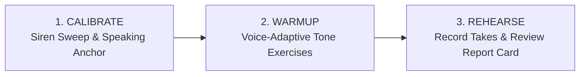
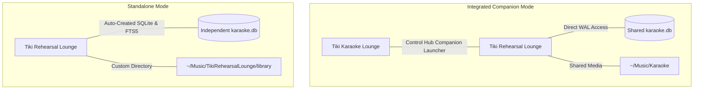

# 🌺 Tiki Rehearsal Lounge (Vocal Coach & Studio)

[](https://github.com/Todd0042/tiki-rehearsal-lounge/releases)
[](LICENSE)
[%20%7C%20Python-orange.svg)](https://github.com/Todd0042/tiki-rehearsal-lounge/releases)
[]()
[]()
[](https://ko-fi.com/todd0042)

> **Your personal vocal gym, pitch calibration laboratory, and post-take performance report card studio — companion to Tiki Karaoke or 100% standalone.**

---

## 📖 Table of Contents

* **Part 1 — Vocalist Overview & Quick Start**
  * [🍹 What Is Tiki Rehearsal Lounge?](#-what-is-tiki-rehearsal-lounge)
  * [🎤 3 Steps to Vocal Mastery (Calibrate, Warmup, Rehearse)](#-3-steps-to-vocal-mastery)
  * [📸 Visual Tour & Studio Cockpit](#-visual-tour--studio-cockpit)
  * [✨ Feature Highlights at a Glance](#-feature-highlights-at-a-glance)
  * [🚀 Quick Download & Installation (Linux AppImage & Source)](#-quick-download--installation)
* **Part 2 — Technical Architecture & Scientific DSP Reference**
  * [1. Dual-Architecture & Integration (Standalone vs. Tiki Karaoke Companion)](#1-dual-architecture--integration)
  * [2. Vocal Diagnostic Calibration Engine (Siren Glides & Speaking Fundamental $F_0$)](#2-vocal-diagnostic-calibration-engine)
  * [3. Smart Key Recommendation Engine ($[-3, +3]$ Semitone Range)](#3-smart-key-recommendation-engine)
  * [4. Multi-Metric Performance Take Analysis (Pitch %, Intonation Cents, Rhythm Pocket, Vibrato)](#4-multi-metric-performance-take-analysis)
  * [5. 100% Offline Rule-Based Vocal Coach (`ai/offline_coach.py`)](#5-100-offline-vocal-coach)
  * [6. Multi-Instrument Procedural Tone Synthesizer & Warmup Patterns](#6-multi-instrument-procedural-tone-synthesizer)
  * [7. SQLite Database Schema, FTS5 Fast Search & Metadata Editing](#7-sqlite-database-schema-fts5-search--metadata-editing)
  * [8. Downloader, LUFS Normalization & File Relocation](#8-downloader-lufs-normalization--file-relocation)
  * [9. Configuration Schema (`config.json`) & CLI Options](#9-configuration-schema--cli-options)
  * [10. Automated Verification Suite & Building the AppImage](#10-automated-verification-suite--building-the-appimage)
  * [11. Ethics, Clean-Room Audio Provenance, BYOM Disclaimers & Licensing](#11-ethics-clean-room-audio-provenance--licensing)

---

# Part 1 — Vocalist Overview & Quick Start

## 🍹 What Is Tiki Rehearsal Lounge?

**Tiki Rehearsal Lounge** is a self-hosted desktop vocal training and performance rehearsal environment. Engineered as both an optional companion to [Tiki Karaoke Lounge](https://github.com/Todd0042/tiki-karaoke) and a fully independent standalone product, it provides singers with:

1. **🔬 Scientific Pitch & Vocal Range Calibration**: Unlocks your true vocal range ($F_{0,\text{min}}$ to $F_{0,\text{max}}$) and calculates your **Power Tessitura Zone** ($+3$ to $+14$ semitones above speaking fundamental).
2. **🎹 Guided Warmup Studio**: Procedural multi-instrument reference tones (Piano, Rhodes, Strings, Flute, Guitar, Brass) with real-time pitch feedback to prepare your vocal folds safely.
3. **🎵 Formant-Preserving Key Shifting**: Rehearse tracks with real-time `librubberband` key transposition without pitch chipmunking or tempo distortion.
4. **📊 Post-Take Report Cards**: Instant breakdown of pitch accuracy %, flat/sharp intonation drift in cents, millisecond rhythm onset timing, and natural vibrato modulation.
5. **🧠 100% Offline Vocal Coach**: Provides actionable pedagogical physical adjustments ("drop the jaw", "expand lower ribcage") and timestamped phrase feedback with zero telemetry, zero cloud calls, and zero external subscriptions.

---

## 🎤 3 Steps to Vocal Mastery



1. **Step 1: Calibrate Your Instrument**: Run the 2-minute diagnostic. Slide your pitch from your lowest tone to highest siren peak, then count backwards from 20 to establish your resting conversational pitch anchor.
2. **Step 2: Warm Up Smartly**: Select an adaptive warmup workout tailored to your vocal classification (Bass, Baritone, Tenor, Contralto, Mezzo, Soprano) or target rehearsal song.
3. **Step 3: Rehearse & Analyze**: Select a karaoke or sing-along track, shift to your recommended power key, record your vocal take, and inspect your objective post-performance score.

---

## 📸 Visual Tour & Studio Cockpit

### 🎛️ Studio Cockpit Window
The desktop interface is rendered in Tiki's signature `#0d0814` midnight violet palette, featuring:
* **Audio Device Matrix**: Live microphone input selector, output monitor selector, and real-time animated neon VU meters.
* **Real-Time Visualizer Canvas**: Real-time waveform display with pitch tracking and target pitch reference guide lines.
* **Live Transposition Transport**: Shift track pitch by semitones in real-time ($\pm 3$ semitones) while monitoring vocal accuracy.
* **4 Dedicated Workstation Tabs**:
  * 🎹 **Vocal Warmups**: Multi-instrument arpeggios, pentatonic runs, staccato triads, and lip trills.
  * 🎙️ **Smart Rehearsal & Take Recording**: Transport player, microphone recorder, and real-time smart key suggestions.
  * 📂 **Song Library & Downloader**: Instant FTS5 catalog search, YouTube fetch with LUFS normalization, and track metadata editor.
  * 📜 **Performance Take History**: Archive of past recordings, scores, intonation drift metrics, and coach feedback.

---

## ✨ Feature Highlights at a Glance

* **🎯 100% Standalone Readiness**: Operates completely independently without requiring Tiki Karaoke. Automatically creates and manages its own SQLite schema (`tracks`, `tracks_fts`, triggers, indices).
* **🤝 One-Click Tiki Karaoke Integration**: If Tiki Karaoke is present on the machine, Rehearsal Lounge automatically discovers the shared `karaoke.db` and can be launched directly from Tiki Karaoke's Desktop Control Hub.
* **⚙️ In-App Settings Dialog**: Change storage architecture (`integrated` vs `standalone`), select library/database/recordings directories with native OS browse dialogs, and configure target loudness (-16.0 or -23.0 LUFS).
* **🎚️ Safe Key Transposition ($[-3, +3]$)**: Automatically analyzes melodic ceiling demands against your physiological tessitura to calculate optimal key changes without audio degradation.
* **✏️ Track Metadata Sanitation**: Directly edit Artist, Title, Original Title, and Song Type (Karaoke vs. Sing-Along) with automatic file relocation between `tracks/` and `sing_along/`.
* **🔒 100% Private & Offline**: Zero telemetry, zero cloud accounts, and zero internet connectivity needed to rehearse, calibrate, or run the vocal coach.

---

## 🚀 Quick Download & Installation

### Option A: Universal Linux AppImage (Recommended)

1. Download the latest **`TikiRehearsalLounge-v1.0.0-x86_64.AppImage`** from [GitHub Releases](https://github.com/Todd0042/tiki-rehearsal-lounge/releases).
2. Make it executable and run:
   ```bash
   chmod +x TikiRehearsalLounge-v1.0.0-x86_64.AppImage
   ./TikiRehearsalLounge-v1.0.0-x86_64.AppImage
   ```

### Option B: Running from Source (Linux & Cross-Platform)

#### 1. System Prerequisites
Ensure Python 3.10+, `mpv`, `ffmpeg`, and `tk` (Tkinter) are installed:
```bash
# Ubuntu / Debian / Linux Mint:
sudo apt-get install python3 python3-pip python3-tk mpv ffmpeg

# Arch Linux / Manjaro:
sudo pacman -S python python-pip tk mpv ffmpeg

# Fedora / Red Hat:
sudo dnf install python3 python3-pip python3-tkinter mpv ffmpeg
```

#### 2. Clone and Install
```bash
git clone https://github.com/Todd0042/tiki-rehearsal-lounge.git
cd tiki-rehearsal-lounge
pip install -r requirements.txt
```

#### 3. Launching
```bash
# Launch Desktop Studio Cockpit (Tkinter GUI):
python main.py

# Or launch Interactive Terminal Cockpit directly (zero-GUI environments):
python main.py --cli
```

---

# Part 2 — Technical Architecture & Scientific DSP Reference

## 1. Dual-Architecture & Integration

Tiki Rehearsal Lounge supports two operating paradigms governed by `~/.config/TikiRehearsalLounge/config.json`:



* **Integrated Companion Mode (`"storage_mode": "integrated"`)**:
  * Inherits library directory and database directly from `~/.config/TikiKaraoke/config.json`.
  * Changes, downloads, and metadata edits sync bidirectionally in real-time with Tiki Karaoke.
* **Standalone Mode (`"storage_mode": "standalone"`)**:
  * Stores catalog in a dedicated folder (`~/Music/TikiRehearsalLounge/library`).
  * Auto-initializes schema without throwing missing-file errors.

---

## 2. Vocal Diagnostic Calibration Engine

Human vocal classification often relies on subjective range labeling. Tiki Rehearsal Lounge applies empirical pitch analysis using normalized autocorrelation:

$$\text{MIDI}(f) = 69 + 12 \cdot \log_2\left(\frac{f}{440}\right)$$

### Exercise 1: Siren Pitch Sweep ("Ooo ➔ Aaa")
* Singer glides continuously from vocal fry / lowest chest tone to highest falsetto/head voice siren peak.
* Discards unvoiced noise bursts ($<35\%$ autocorrelation peak) and maps absolute physiological bounds:
  $$F_{0,\text{min}} \quad \text{and} \quad F_{0,\text{max}}$$

### Exercise 2: Speaking Anchor ("Counting 20 ➔ 0")
* Singer counts downward in relaxed conversational voice.
* Computes the median frequency of the lower $35\%$ quartile of sustained speech frames:
  $$F_{0,\text{anchor}}$$
* **Power Tessitura Zone**: Studies demonstrate a singer's most sustainable, fatigue-free belting and resonance zone sits between $+3$ and $+14$ semitones above their habitual speech anchor:
  $$\text{Tessitura}_{\text{min}} = \text{MIDI}(F_{0,\text{anchor}}) + 3$$
  $$\text{Tessitura}_{\text{max}} = \text{MIDI}(F_{0,\text{anchor}}) + 14$$

---

## 3. Smart Key Recommendation Engine

When a track is selected, the engine evaluates the song's melodic peak demand against your calibrated ceiling:

$$\Delta = \text{round}\left(\text{MIDI}(\text{Tessitura}_{\text{max}}) - \text{MIDI}(\text{Song}_{\text{peak}})\right)$$

$$\text{Shift}_{\text{clamped}} = \max(-3, \min(3, \Delta))$$

* Transposition is strictly bounded between **$-3$ and $+3$ semitones** to preserve acoustic naturalism and prevent artifacting in polyphonic backing stems.
* Accompanied by clear rationale (e.g., *"Shift -2 semitones: Drops song climax from B4 down to A4, bringing it into your sweet spot without strain"*).

---

## 4. Multi-Metric Performance Take Analysis

Upon finishing a recorded take, the vocal stem is evaluated against four objective pillars:

| Metric | Target / Safe Window | Description |
| :--- | :--- | :--- |
| **Pitch Accuracy %** | $\ge 85\%$ | Percentage of voiced phonation frames landing within a $\pm 50$ cents quarter-tone window of the target note. |
| **Intonation Drift** | $-10 \text{ to } +10 \text{ cents}$ | Median signed intonation offset in cents. Identifies physical fatigue (sagging flat) or neck tension (pushing sharp). |
| **Rhythm Pocket** | $\le \pm 35 \text{ ms}$ | Median attack onset latency relative to rhythmic beat transients. Categorized as *Locked On*, *Rushing*, or *Dragging*. |
| **Vibrato Dynamics** | $4.5 - 7.0 \text{ Hz}$ | Natural modulation frequency and depth in cents (typically $30 - 90 \text{ cents}$). Flags artificial pitch wobble or rigid straight-tone tension. |

---

## 5. 100% Offline Vocal Coach

The built-in vocal coach (`ai/offline_coach.py`) operates under two complementary modes:

1. **Pedagogical Rule-Based Diagnostic (Default)**:
   * Instant, deterministic feedback engine synthesizing scores, breath stability %, and timestamped phrase moments (e.g., *"[0:32] G4: Vocal pushed sharp on belting vowel"*).
   * Generates targeted physical adjustments (*"Drop jaw and lift soft palate before ascending"*).
2. **Local GGUF LLM Execution (Optional)**:
   * Supports local on-device small language models (e.g., Qwen 2.5 1.5B / Llama 3.2 1B GGUF) via `llama-cpp-python`.
   * Never transmits audio or user data outside your local workstation.

---

## 6. Multi-Instrument Procedural Tone Synthesizer

All warmup reference tones are procedurally generated in pure Python (`audio/tone_generator.py`) using harmonic additive synthesis:

$$s(t) = \sum_{k=1}^{N} A_k \cdot \sin(2\pi \cdot k \cdot f \cdot t) \cdot e^{-\alpha_k t}$$

* **Instruments**: Acoustic Grand Piano, Rhodes Electric Piano, Cello & Warm Strings, Synth Flute, Acoustic Guitar, Warm Brass.
* **Vocal-Type Adaptive Sorting**: Reorders instrument selection based on voice classification (e.g., Cello prioritized for Bass/Baritone; Flute prioritized for Soprano).
* **Warmup Routines**: Arpeggios, 5-tone pentatonics, octave sirens, staccato triads, and lip trills with native playback via `pw-play`, `paplay`, or `aplay`.

---

## 7. SQLite Database Schema, FTS5 Search & Metadata Editing

Tiki Rehearsal Lounge uses a concurrent SQLite WAL database architecture identical to Tiki Karaoke:

```sql
CREATE TABLE IF NOT EXISTS tracks (
    id INTEGER PRIMARY KEY AUTOINCREMENT,
    video_id TEXT UNIQUE NOT NULL,
    title TEXT NOT NULL,
    artist TEXT NOT NULL,
    original_title TEXT NOT NULL,
    channel TEXT DEFAULT '',
    duration INTEGER DEFAULT 0,
    is_downloaded INTEGER DEFAULT 0,
    local_path TEXT DEFAULT '',
    normalized_lufs REAL DEFAULT -16.0,
    download_status TEXT DEFAULT 'idle',
    created_at TIMESTAMP DEFAULT CURRENT_TIMESTAMP,
    play_count INTEGER DEFAULT 0,
    last_played TIMESTAMP,
    is_sing_along INTEGER DEFAULT 0,
    genre TEXT DEFAULT '',
    year INTEGER DEFAULT 0,
    album TEXT DEFAULT ''
);

CREATE VIRTUAL TABLE IF NOT EXISTS tracks_fts USING fts5(
    title,
    artist,
    original_title,
    channel,
    content='tracks',
    content_rowid='id'
);
```

### In-App Metadata & File Relocation
Users can edit Artist, Title, and Song Type (Karaoke vs. Sing-Along) directly in the UI. When toggling between Karaoke and Sing-Along, the downloader engine relocates both video (`.mp4`) and CD+G companion (`.cdg`) files cleanly between `tracks/<Artist>/` and `sing_along/<Artist>/`, sanitizing directory paths and pruning empty directories.

---

## 8. Downloader, LUFS Normalization & File Relocation

* **YouTube Integration**: Powered by `yt-dlp` with targeted query extraction (`karaoke` vs `sing along` guide vocals).
* **EBU R128 Loudness Normalization**: Normalizes tracks via two-pass FFmpeg loudnorm filter:
  * **Standard Streaming**: `-16.0 LUFS` (matching Tiki Karaoke default).
  * **Broadcast Professional**: `-23.0 LUFS` (EBU R128 target).

---

## 9. Configuration Schema & CLI Options

Configuration is stored at `~/.config/TikiRehearsalLounge/config.json`:

```json
{
  "storage_mode": "integrated",
  "library_dir": "/home/user/Music/Karaoke",
  "data_dir": "/home/user/.config/TikiKaraoke",
  "recordings_dir": "/home/user/Music/Karaoke/recordings",
  "target_lufs": -16.0,
  "video_quality_profile": "pro"
}
```

### Command Line Flags
```text
options:
  -h, --help    Show this help message and exit
  --cli         Launch interactive ANSI terminal cockpit directly (zero-GUI mode)
```

---

## 10. Automated Verification Suite & Building the AppImage

### Running the Test Suite
The repository includes 24 automated unit and DSP tests:
```bash
python3 -m unittest discover tests -v
```

### Building the Linux AppImage
Builds a backward-compatible AppImage inside an isolated Debian Bookworm container:
```bash
./build_appimage.sh
```
The compiled package will be placed at `dist/TikiRehearsalLounge-v1.0.0-x86_64.AppImage`.

---

## 11. Ethics, Clean-Room Audio Provenance & Licensing

### 🌺 1. Bring-Your-Own-Media (BYOM) Architecture
* Tiki Rehearsal Lounge is an independent audio analysis player and rehearsal coach. **The repository and release packages do not host, bundle, or distribute copyrighted third-party songs or commercial tracks.**
* Users supply their own personal media libraries or legally sourced backing tracks.

### 🎹 2. 100% Clean-Room Procedural Tone Provenance
* All reference tones in `audio/tone_generator.py` are mathematically synthesized from pure oscillators with **zero external samples, zero proprietary soundfonts, and zero generative AI audio models**.

### 🔒 3. Zero Telemetry, Zero Ads, 100% Local Data Ownership
* Contains **zero analytics trackers, zero telemetry, zero advertisements, and zero mandatory cloud accounts**. Your vocal calibration profile, recordings, and rehearsal scores remain exclusively on your local machine.

### ⚖️ 4. Software License & Commercial Inquiries
* **Non-Commercial Use (Free & Open Source)**: Tiki Rehearsal Lounge is licensed under the **[PolyForm Noncommercial License 1.0.0](LICENSE)**.
* **Commercial Licensing Inquiries**: Commercial use (vocal academies, studios, paid workshops) requires a commercial license. Inquiries: **[todd.0042.git@gmail.com](mailto:todd.0042.git@gmail.com)**.
* **Third-Party Open-Source Attributions**: FFmpeg, MPV, `yt-dlp`, NumPy, SciPy, Pillow, and Python runtime licenses are preserved and respected.

---

<p align="center">
  If you enjoy rehearsing with Tiki Rehearsal Lounge, consider supporting open-source development:<br/><br/>
  <a href="https://ko-fi.com/todd0042" target="_blank">
    
  </a>
</p>
