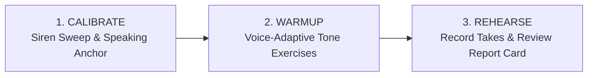
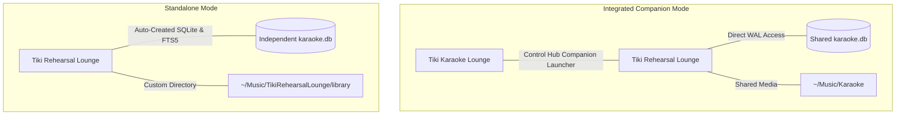
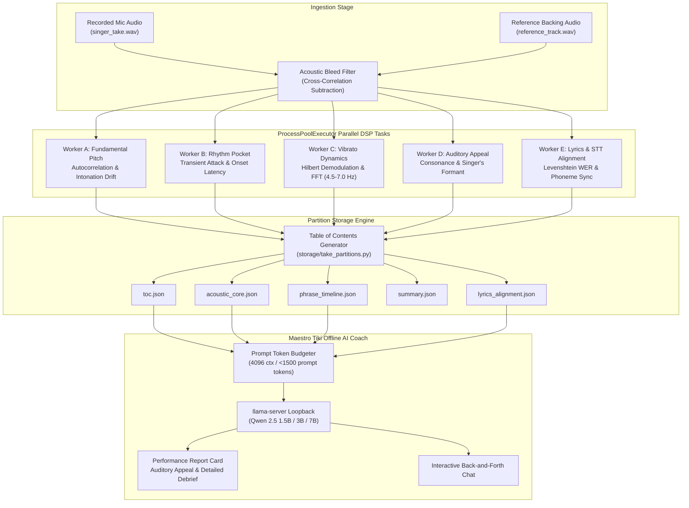
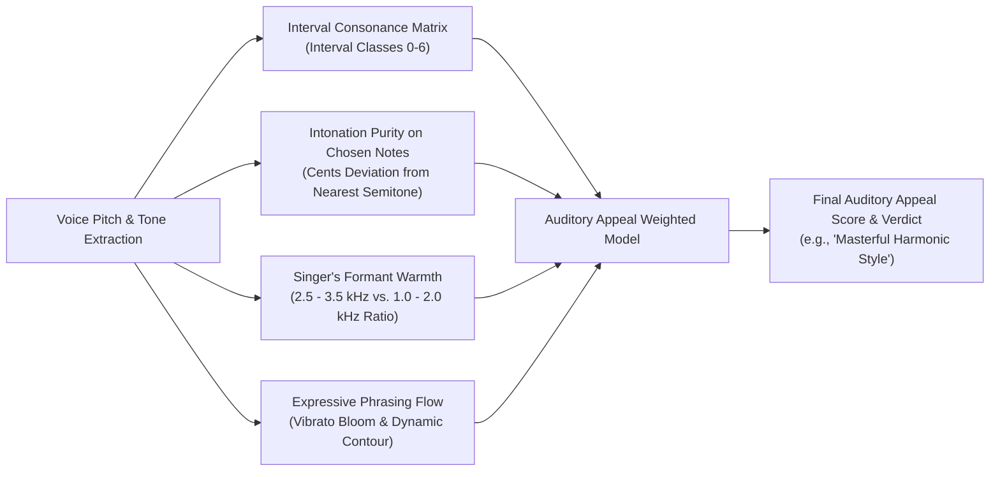
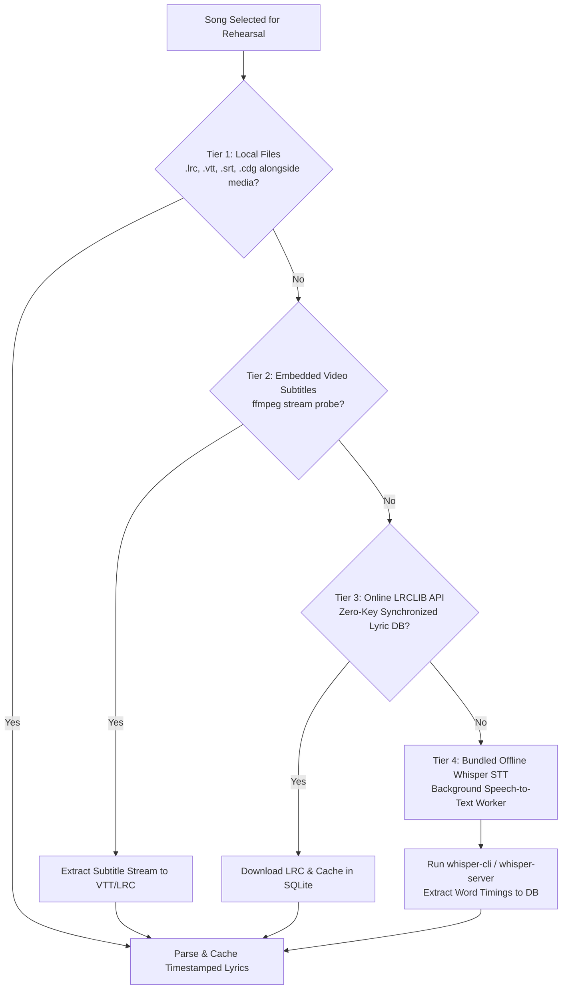
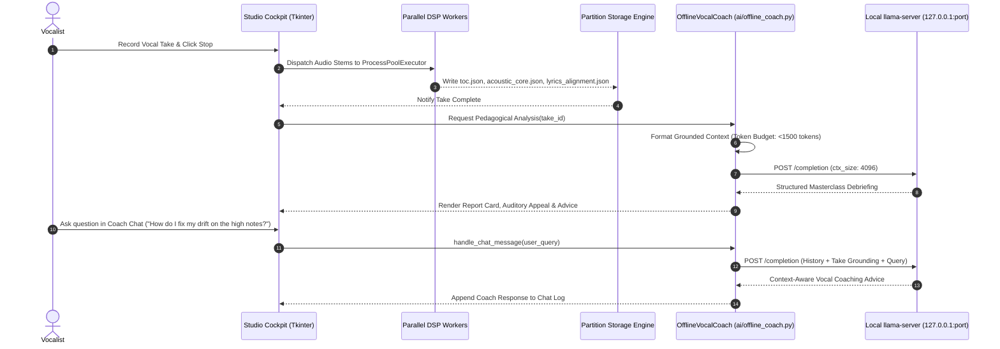

<p align="center">
  <a href="https://ko-fi.com/todd0042">
    
  </a>
</p>

---

# 🌺 Tiki Rehearsal Lounge (Vocal Coach & Studio)

[](https://github.com/Todd0042/tiki-rehearsal-lounge/releases)
[](LICENSE)
[%20%7C%20Windows-orange.svg)](https://github.com/Todd0042/tiki-rehearsal-lounge/releases)
[]()
[]()
[](https://ko-fi.com/todd0042)

> **Your personal vocal gym, pitch calibration laboratory, multi-core DSP studio, and post-take performance report card studio — companion to Tiki Karaoke or 100% standalone.**

---

## 📖 Table of Contents

* **Part 1 — Vocalist Overview & Quick Start**
  * [🍹 What Is Tiki Rehearsal Lounge?](#-what-is-tiki-rehearsal-lounge)
  * [🎤 3 Steps to Vocal Mastery (Calibrate, Warmup, Rehearse)](#-3-steps-to-vocal-mastery)
  * [📸 Visual Tour & Studio Cockpit](#-visual-tour--studio-cockpit)
  * [✨ Feature Highlights at a Glance](#-feature-highlights-at-a-glance)
  * [🚀 Quick Download & Installation (Linux AppImage & Windows Setup)](#-quick-download--installation)
* **Part 2 — Technical Architecture & Scientific DSP Reference**
  * [1. Dual-Architecture & Integration (Standalone vs. Tiki Karaoke Companion)](#1-dual-architecture--integration)
  * [2. Parallel Multi-Core Python DSP Analysis Pipeline](#2-parallel-multi-core-python-dsp-analysis-pipeline)
  * [3. Partitioned Take Storage Engine (`take_partitions.py` & `toc.json`)](#3-partitioned-take-storage-engine)
  * [4. Vocal Diagnostic Calibration Engine (Siren Glides & Speaking Fundamental $F_0$)](#4-vocal-diagnostic-calibration-engine)
  * [5. Smart Key Recommendation Engine ($[-3, +3]$ Semitone Range)](#5-smart-key-recommendation-engine)
  * [6. Objective Performance Take Analysis & Bleed Suppression](#6-objective-performance-take-analysis--bleed-suppression)
  * [7. Auditory Appeal & Harmonic Consonance Mathematical Model](#7-auditory-appeal--harmonic-consonance-mathematical-model)
  * [8. Multi-Tier Ground-Truth Lyric Synchronization & Bundled Whisper STT](#8-multi-tier-ground-truth-lyric-synchronization--bundled-whisper-stt)
  * [9. 100% Offline AI Vocal Coach & Agent Workflow (`ai/offline_coach.py`)](#9-100-offline-ai-vocal-coach--agent-workflow)
  * [10. Rolling Progression Database (`rehearsal_history.db`)](#10-rolling-progression-database)
  * [11. Multi-Instrument Procedural Tone Synthesizer & Warmup Patterns](#11-multi-instrument-procedural-tone-synthesizer)
  * [12. SQLite Database Schema, FTS5 Search & Metadata Editing](#12-sqlite-database-schema-fts5-search--metadata-editing)
  * [13. Downloader, LUFS Normalization & File Relocation](#13-downloader-lufs-normalization--file-relocation)
  * [14. Configuration Schema (`config.json`) & CLI Options](#14-configuration-schema--cli-options)
  * [15. Automated Verification Suite & Build System](#15-automated-verification-suite--build-system)
  * [16. Ethics, Clean-Room Audio Provenance, BYOM Disclaimers & Licensing](#16-ethics-clean-room-audio-provenance--licensing)

---

# Part 1 — Vocalist Overview & Quick Start

## 🍹 What Is Tiki Rehearsal Lounge?

**Tiki Rehearsal Lounge** is a self-hosted desktop vocal training and performance rehearsal environment. Engineered as both an optional companion to [Tiki Karaoke Lounge](https://github.com/Todd0042/tiki-karaoke) and a fully independent standalone product, it provides singers with:

1. **🔬 Scientific Pitch & Vocal Range Calibration**: Unlocks your true vocal range ($F_{0,\text{min}}$ to $F_{0,\text{max}}$) and calculates your **Power Tessitura Zone** ($+3$ to $+14$ semitones above speaking fundamental).
2. **🎹 Guided Warmup Studio**: Procedural multi-instrument reference tones (Piano, Rhodes, Strings, Flute, Guitar, Brass) with real-time pitch feedback to prepare your vocal folds safely.
3. **🎵 Formant-Preserving Key Shifting**: Rehearse tracks with real-time `librubberband` key transposition without pitch chipmunking or tempo distortion.
4. **📊 Post-Take Report Cards with Audio Bleed Cancellation**: Instant breakdown of pitch accuracy %, flat/sharp intonation drift in cents, millisecond rhythm onset timing, and natural vibrato modulation—with reference audio subtraction to prevent false high scores on silent speaker bleed.
5. **✨ Auditory Appeal & Musicality Metric**: Evaluates how harmonically and psychoacoustically pleasing your performance is to human listeners. Rather than penalizing vocalists who reharmonize or improvise over the melody, this metric grades interval consonance, intonation purity, and vocal warmth.
6. **🧠 100% Offline AI Vocal Coach & Progression Tracker**: Powered by a bundled standalone `llama.cpp` engine running local open-weights models (Qwen 2.5 7B, 3B, or 1.5B) with one-click **⚡ GPU (VRAM offload)** or **🖥️ CPU** execution. Delivers deep, grounded debriefs and an interactive chat interface without transmitting a single byte over the internet.
7. **⚡ True Multi-Core Concurrency**: Dynamic process scheduling allocates DSP extraction tasks across your available CPU cores (scalable from single-core budget hardware to 27+ core workstations).
8. **🔁 Take Continuity & Progression Reloading**: When you launch the studio, your latest recorded take, metrics, lyrics, and report card are automatically restored so you can immediately resume your rehearsal journey.

---

## 🎤 3 Steps to Vocal Mastery



1. **Step 1: Calibrate Your Instrument**: Run the 2-minute diagnostic. Slide your pitch from your lowest tone to highest siren peak, then count backwards from 20 to establish your resting conversational pitch anchor.
2. **Step 2: Warm Up Smartly**: Select an adaptive warmup workout tailored to your vocal classification (Bass, Baritone, Tenor, Contralto, Mezzo, Soprano) or target rehearsal song.
3. **Step 3: Rehearse & Analyze**: Select a karaoke or sing-along track, shift to your recommended power key, record your vocal take, and inspect your objective post-performance score.

---

## 📸 Visual Tour & Studio Cockpit

### 🎛️ Studio Cockpit Window
The desktop interface is rendered in Tiki's signature `#0d0814` midnight violet palette, featuring:
* **Audio Device Matrix**: Live microphone input selector, output monitor selector, and real-time animated neon VU meters.
* **Real-Time Visualizer Canvas**: Real-time waveform display with pitch tracking and target pitch reference guide lines.
* **Live Transposition Transport**: Shift track pitch by semitones in real-time ($\pm 3$ semitones) while monitoring vocal accuracy.
* **Performance Report Card**:
  * **Take Score** (top-left, large 44pt gold score).
  * **Auditory Appeal** (top-right, 36pt gold musicality rating and dynamic verdict).
  * **Diagnostic Metrics Grid**: Pitch Accuracy %, Median Intonation (cents), Rhythm Pocket (ms), Vibrato Modulation (Hz / cents), and Diaphragmatic Breath Stability %.
  * **Lyric Alignment Feedback**: Word error rates, dropped lyrics, and onset timing delta.
  * **Maestro Tiki Interactive AI Chat**: Interactive debriefing and voice coach Q&A powered by local LLM.
* **4 Dedicated Workstation Tabs**:
  * 🎹 **Vocal Warmups**: Multi-instrument arpeggios, pentatonic runs, staccato triads, and lip trills.
  * 🎙️ **Smart Rehearsal & Take Recording**: Transport player, microphone recorder, and real-time smart key suggestions.
  * 📂 **Song Library & Downloader**: Instant FTS5 catalog search, YouTube fetch with LUFS normalization, and track metadata editor.
  * 📜 **Performance Take History**: Archive of past recordings, scores, intonation drift metrics, and coach feedback.

---

## ✨ Feature Highlights at a Glance

* **🎯 100% Standalone Readiness**: Operates completely independently without requiring Tiki Karaoke. Automatically creates and manages its own SQLite schema (`tracks`, `tracks_fts`, triggers, indices).
* **🤝 One-Click Tiki Karaoke Integration**: If Tiki Karaoke is present on the machine, Rehearsal Lounge automatically discovers the shared `karaoke.db` and can be launched directly from Tiki Karaoke's Desktop Control Hub.
* **⚙️ In-App Settings Dialog**: Change storage architecture (`integrated` vs `standalone`), select library/database/recordings directories with native OS browse dialogs, and configure target loudness (-16.0 or -23.0 LUFS).
* **🎚️ Safe Key Transposition ($[-3, +3]$)**: Automatically analyzes melodic ceiling demands against your physiological tessitura to calculate optimal key changes without audio degradation.
* **🔇 Acoustic Bleed Cancellation**: Cross-correlates mic audio against backing track audio to discard matching speaker bleed at ambient noise levels, preventing false 90%+ scores when remaining silent.
* **🎼 Auditory Appeal Analysis**: Evaluates creative phrasing, consonant harmony intervals, and singer's formant warmth to reward personal artistic style over rote pitch mimicry.
* **⚡ Multi-Core Parallel DSP**: Deploys independent analyzer worker processes with dynamic CPU load balancing.
* **📜 Multi-Tier Ground-Truth Lyrics**: Resolves synchronized lyrics from local LRC/VTT/SRT/CDG files, embedded video subtitle tracks, public synced APIs, or bundled offline Whisper speech recognition.
* **💾 Modular Partitioned Storage**: Saves take telemetry into segregated JSON partitions (`toc.json`, `acoustic_core.json`, `phrase_timeline.json`, `lyrics_alignment.json`) for instant loading and token-efficient AI prompts.
* **📈 Rolling Progression Database**: Stores take-over-take performance data in an isolated, auto-pruned `rehearsal_history.db` to deliver growth trajectory summaries without database bloat.
* **🔒 100% Private & Offline**: Zero telemetry, zero cloud accounts, and zero internet connectivity needed to rehearse, calibrate, or run the vocal coach.

---

## 🚀 Quick Download & Installation

### Option A: Universal Linux AppImage
1. Download **`TikiRehearsalLounge-v1.0.7-x86_64.AppImage`** from [GitHub Releases](https://github.com/Todd0042/tiki-rehearsal-lounge/releases) or [itch.io](https://todd0042.itch.io/tiki-karaoke-lounge) (`rehearsal-linux` channel).
2. Make it executable and run:
   ```bash
   chmod +x TikiRehearsalLounge-v1.0.7-x86_64.AppImage
   ./TikiRehearsalLounge-v1.0.7-x86_64.AppImage
   ```

### Option B: Windows 10 & 11 (64-Bit)
Download from [GitHub Releases](https://github.com/Todd0042/tiki-rehearsal-lounge/releases) or [itch.io](https://todd0042.itch.io/tiki-karaoke-lounge):
* **Turnkey Installer**: Run **`TikiRehearsalLoungeSetup-v1.0.7.exe`** (channel: `rehearsal-windows`) for Start Menu and Desktop shortcuts.
* **Portable ZIP**: Extract **`TikiRehearsalLounge-Windows-v1.0.7.zip`** (channel: `rehearsal-windows-portable`) and launch `TikiRehearsalLounge.exe` (no administrator privileges required).

### Option C: Running from Source (Linux & Cross-Platform)

#### 1. System Prerequisites
Ensure Python 3.10+, `mpv`, `ffmpeg`, and `tk` (Tkinter) are installed:
```bash
# Ubuntu / Debian / Linux Mint:
sudo apt-get install python3 python3-pip python3-tk mpv ffmpeg

# Arch Linux / Manjaro:
sudo pacman -S python python-pip tk mpv ffmpeg

# Fedora / Red Hat:
sudo dnf install python3 python3-pip python3-tkinter mpv ffmpeg
```

#### 2. Clone and Install
```bash
git clone https://github.com/Todd0042/tiki-rehearsal-lounge.git
cd tiki-rehearsal-lounge
pip install -r requirements.txt
```

#### 3. Launching
```bash
# Launch Desktop Studio Cockpit (Tkinter GUI):
python main.py

# Or launch Interactive Terminal Cockpit directly (zero-GUI environments):
python main.py --cli
```

---

# Part 2 — Technical Architecture & Scientific DSP Reference

## 1. Dual-Architecture & Integration

Tiki Rehearsal Lounge supports two operating paradigms governed by `~/.config/TikiRehearsalLounge/config.json`:



* **Integrated Companion Mode (`"storage_mode": "integrated"`)**:
  * Inherits library directory and database directly from `~/.config/TikiKaraoke/config.json`.
  * Changes, downloads, and metadata edits sync bidirectionally in real-time with Tiki Karaoke.
* **Standalone Mode (`"storage_mode": "standalone"`)**:
  * Stores catalog in a dedicated folder (`~/Music/TikiRehearsalLounge/library`).
  * Auto-initializes schema without throwing missing-file errors.

---

## 2. Parallel Multi-Core Python DSP Analysis Pipeline

Upon take completion, raw vocal audio (`singer_take.wav`) and the reference backing stem (`reference_track.wav`) enter a high-throughput, non-blocking parallel extraction pipeline designed to bypass Python's Global Interpreter Lock (GIL).

### Concurrency Architecture & Dynamic Core Allocation

The execution engine in `audio/parallel_analyzer.py` uses `concurrent.futures.ProcessPoolExecutor`. Rather than pinning threads or risking lockups on low-spec hardware (such as dual-core Intel Celerons) or underutilizing high-core workstations (such as 24-core or 32-core systems), worker allocation scales dynamically:

```python
workers = max(1, min(os.cpu_count() or 4, 27))
```

Tasks are submitted as unblocked futures to an asynchronous job queue. When a CPU core finishes a stage, the next waiting feature extractor is assigned instantly without busy-wait spinlocks.



---

## 3. Partitioned Take Storage Engine

To prevent UI stalls, avoid database bloat, and protect LLM token context windows, performance take data is saved into structured, human-readable JSON partitions under `take_recordings/<take_id>/`:

```text
take_recordings/
└── 20261104_152342_BohemianRhapsody/
    ├── singer_take.wav          # Clean recorded vocal take (16-bit 44.1kHz PCM)
    ├── toc.json                 # Master manifest & partition index
    ├── acoustic_core.json       # Scalar performance metrics & overall grades
    ├── phrase_timeline.json     # High-resolution time-series note pitch arrays
    ├── lyrics_alignment.json    # Transcribed words, targets, WER, and sync offsets
    └── summary.json             # Compact token-optimized rollup for AI prompts
```

### Manifest Specification (`toc.json`)
The `toc.json` file serves as the lookup directory for the application and AI coach:

```json
{
  "take_id": "20261104_152342_BohemianRhapsody",
  "track_title": "Bohemian Rhapsody",
  "artist": "Queen",
  "timestamp": "2026-11-04T15:23:42",
  "version": "1.0.7",
  "partitions": {
    "acoustic_core": {
      "file": "acoustic_core.json",
      "records": 12,
      "bytes": 1048
    },
    "phrase_timeline": {
      "file": "phrase_timeline.json",
      "records": 48,
      "bytes": 34912
    },
    "lyrics_alignment": {
      "file": "lyrics_alignment.json",
      "records": 215,
      "bytes": 8412
    },
    "summary": {
      "file": "summary.json",
      "records": 1,
      "bytes": 512
    }
  }
}
```

### Partition Responsibilities
* **`acoustic_core.json`**: Contains aggregate take statistics: `overall_score`, `auditory_appeal_score`, `harmonic_consonance_pct`, `pitch_accuracy_pct`, `median_drift_cents`, `rhythm_pocket_ms`, `vibrato_rate_hz`, and `vibrato_extent_cents`. Loaded instantly by the report card UI.
* **`phrase_timeline.json`**: Note-by-note pitch arrays, transient attack envelopes, and flat/sharp deviations indexed by millisecond timestamps. Sampled on demand when the user or AI coach inspects a specific phrase.
* **`lyrics_alignment.json`**: Ground-truth target words, transcribed vocal words, word-level error rate (WER), missing phrases, and sync offsets.
* **`summary.json`**: A compacted, pre-digested summary used for rapid take history lists and token-capped LLM prompts.

---

## 4. Vocal Diagnostic Calibration Engine

Human vocal classification often relies on subjective range labeling. Tiki Rehearsal Lounge applies empirical pitch analysis using normalized autocorrelation:

$$\text{MIDI}(f) = 69 + 12 \cdot \log_2\left(\frac{f}{440}\right)$$

### Exercise 1: Siren Pitch Sweep ("Ooo ➔ Aaa")
* Singer glides continuously from vocal fry / lowest chest tone to highest falsetto/head voice siren peak.
* Discards unvoiced noise bursts ($<35\%$ autocorrelation peak) and maps absolute physiological bounds:
  $$F_{0,\text{min}} \quad \text{and} \quad F_{0,\text{max}}$$

### Exercise 2: Speaking Anchor ("Counting 20 ➔ 0")
* Singer counts downward in relaxed conversational voice.
* Computes the median frequency of the lower $35\%$ quartile of sustained speech frames:
  $$F_{0,\text{anchor}}$$
* **Power Tessitura Zone**: Studies demonstrate a singer's most sustainable, fatigue-free belting and resonance zone sits between $+3$ and $+14$ semitones above their habitual speech anchor:
  $$\text{Tessitura}_{\text{min}} = \text{MIDI}(F_{0,\text{anchor}}) + 3$$
  $$\text{Tessitura}_{\text{max}} = \text{MIDI}(F_{0,\text{anchor}}) + 14$$

---

## 5. Smart Key Recommendation Engine

When a track is selected, the engine evaluates the song's melodic peak demand against your calibrated ceiling:

$$\Delta = \text{round}\left(\text{MIDI}(\text{Tessitura}_{\text{max}}) - \text{MIDI}(\text{Song}_{\text{peak}})\right)$$

$$\text{Shift}_{\text{clamped}} = \max(-3, \min(3, \Delta))$$

* Transposition is strictly bounded between **$-3$ and $+3$ semitones** to preserve acoustic naturalism and prevent artifacting in polyphonic backing stems.
* Accompanied by clear rationale (e.g., *"Shift -2 semitones: Drops song climax from B4 down to A4, bringing it into your sweet spot without strain"*).

---

## 6. Objective Performance Take Analysis & Bleed Suppression

Upon finishing a recorded take, the vocal stem is evaluated against four objective pillars:

| Metric | Target / Safe Window | Description |
| :--- | :--- | :--- |
| **Pitch Accuracy %** | $\ge 85\%$ | Percentage of voiced phonation frames landing within a $\pm 50$ cents quarter-tone window of the target note. |
| **Intonation Drift** | $-10 \text{ to } +10 \text{ cents}$ | Median signed intonation offset in cents. Identifies physical fatigue (sagging flat) or neck tension (pushing sharp). |
| **Rhythm Pocket** | $\le \pm 35 \text{ ms}$ | Median attack onset latency relative to rhythmic beat transients. Categorized as *Locked On*, *Rushing*, or *Dragging*. |
| **Vibrato Dynamics** | $4.5 - 7.0 \text{ Hz}$ | Natural modulation frequency and depth in cents (typically $30 - 90 \text{ cents}$). Flags artificial pitch wobble or rigid straight-tone tension. |

### Acoustic Bleed Cancellation
Microphones capture monitor and speaker bleed from the backing track. Tiki Rehearsal Lounge computes the normalized cross-correlation:

$$r_{xy}[k] = \frac{\sum_n x[n] \cdot y[n-k]}{\sqrt{\sum_n x^2[n] \cdot \sum_n y^2[n]}}$$

When vocal energy falls below the noise threshold and matches the reference track signal, the frames are filtered out, preventing artificial high scores when the user does not sing.

---

## 7. Auditory Appeal & Harmonic Consonance Mathematical Model

A common limitation in pitch-correction and scoring software is the rigid penalization of artistic styling. If a vocalist intentionally sings a harmony, adds a soulful blues inflection, or ornaments a phrase, standard 1:1 note matchers score the take as failing.

Tiki Rehearsal Lounge introduces the **Auditory Appeal Metric** ($0 - 100$), displayed directly opposite the Take Score on the Performance Report Card.



### Mathematical Formulation
$$\text{AuditoryAppealScore} = \text{round}\Big(0.45 \cdot C + 0.25 \cdot P + 0.15 \cdot W + 0.15 \cdot F\Big)$$

Where:

#### 1. Harmonic Consonance Percentage ($C \in [0, 100]$)
For each voiced frame where vocal pitch $f_v$ and melody pitch $f_m$ coexist, the engine computes the semitone distance modulo 12:

$$k = \left|\text{round}\left(12 \cdot \log_2\left(\frac{f_v}{f_m}\right)\right)\right| \pmod{12}$$

Intervals are scored according to western psychoacoustic consonance weights:

| Semitone Interval ($k$) | Musical Relationship | Consonance Weight ($w_k$) |
| :---: | :--- | :---: |
| **0** | Perfect Unison / Octave | **1.00** |
| **7** | Perfect Fifth | **0.95** |
| **5** | Perfect Fourth | **0.92** |
| **4** | Major Third | **0.90** |
| **3** | Minor Third | **0.88** |
| **9** | Major Sixth | **0.87** |
| **8** | Minor Sixth | **0.85** |
| **2** | Major Second (Soulful Tension) | **0.70** |
| **10** | Minor Seventh (Blues / Jazz Tension) | **0.70** |
| **11** | Major Seventh | **0.45** |
| **1** | Minor Second | **0.35** |
| **6** | Tritone (Diminished Fifth) | **0.30** |

$$C = 100 \cdot \frac{\sum_{i=1}^{M} w_{k,i}}{M}$$

#### 2. Intonation Purity on Chosen Notes ($P \in [0, 100]$)
A performer who chooses an alternate harmony must still sing that harmony in tune. Intonation purity evaluates how accurately the singer stabilizes on the 12-TET center of their chosen note:

$$\delta_i = \left|1200 \cdot \log_2\left(\frac{f_{v,i}}{f_{\text{target-chosen},i}}\right)\right|$$

$$P = \max\left(0, 100 - 2.0 \cdot \text{median}(\delta)\right)$$

#### 3. Timbral Warmth & Singer's Formant ($W \in [0, 100]$)
Measures vocal fold closure and pharyngeal acoustic resonance by calculating the spectral power ratio in the classic "Singer's Formant" cluster (2.5 kHz – 3.5 kHz) versus the harsh nasal band (1.0 kHz – 2.0 kHz):

$$R_{\text{formant}} = \frac{\int_{2500}^{3500} |S(f)|^2 \, df}{\int_{1000}^{2000} |S(f)|^2 \, df + \epsilon}$$

$$W = \min\left(100, \max\left(20, 20 + 80 \cdot \frac{R_{\text{formant}}}{1.5}\right)\right)$$

#### 4. Phrasing & Dynamic Expressiveness Flow ($F \in [0, 100]$)
Rewards natural vibrato bloom (onset delay of 200–500 ms after note attack) and smooth dynamic volume contouring over robotic, flat-velocity phonation.

---

## 8. Multi-Tier Ground-Truth Lyric Synchronization & Bundled Whisper STT

Accurate lyrical evaluation requires timestamped ground truth. Tiki Rehearsal Lounge implements an automatic multi-tier fallback architecture:



### Automatic Background STT
When neither local nor online lyrics exist, the application launches a background worker (`audio/stt_engine.py`) using bundled offline `whisper.cpp` binaries (`whisper-cli` or `whisper-server`). The worker runs without freezing the UI or delaying rehearsal playback. Once generated, lyrics are indexed in `lyrics_cache.db` so transcription only runs once per song.

---

## 9. 100% Offline AI Vocal Coach & Agent Workflow

The vocal coach subsystem (`ai/offline_coach.py`) combines deterministic pedagogical analysis with local open-weights Large Language Model (LLM) inference.



### Local Loopback Inference Architecture
* **Binary Bundle**: Standalone `llama-server` binary bundled directly inside the AppImage and Windows release packages.
* **Ephemeral Port Assignment**: Dynamically discovers open loopback ports (`127.0.0.1:49152+`) to prevent port collisions.
* **Context Budgeting**: Context window configured to **4,096 tokens** (`--ctx-size 4096`), with prompts budgeted strictly below 1,500 tokens to guarantee fast token throughput and zero context-overflow errors.
* **Deterministic Fallback Engine**: If the local LLM is uninstalled or downloading, `_generate_rule_based_chat_reply()` analyzes the take's intonation, lyrics, and Auditory Appeal to answer questions accurately without hallucinations.

---

## 10. Rolling Progression Database

Performance metrics are saved to `rehearsal_history.db` (`STUDIO_CONFIG_DIR / "data" / "rehearsal_history.db"`), completely segregated from the song catalog:

* **Automatic Rolling Window**: Automatically prunes records to enforce a maximum of **15 takes per song** and **100 takes studio-wide**, keeping prompt token overhead under 200 tokens.
* **Delta Tracking**: Calculates take-over-take variance in overall score, pitch accuracy %, intonation cents drift, and diaphragmatic breath support.
* **Take Continuity**: On application startup, the most recent take is automatically loaded from the partition store, populating the Performance Report Card and coach chat instantly.

---

## 11. Multi-Instrument Procedural Tone Synthesizer

All warmup reference tones are procedurally generated in pure Python (`audio/tone_generator.py`) using harmonic additive synthesis:

$$s(t) = \sum_{k=1}^{N} A_k \cdot \sin(2\pi \cdot k \cdot f \cdot t) \cdot e^{-\alpha_k t}$$

* **Instruments**: Acoustic Grand Piano, Rhodes Electric Piano, Cello & Warm Strings, Synth Flute, Acoustic Guitar, Warm Brass.
* **Vocal-Type Adaptive Sorting**: Reorders instrument selection based on voice classification (e.g., Cello prioritized for Bass/Baritone; Flute prioritized for Soprano).
* **Warmup Routines**: Arpeggios, 5-tone pentatonics, octave sirens, staccato triads, and lip trills with native playback via `pw-play`, `paplay`, or `aplay`.

---

## 12. SQLite Database Schema, FTS5 Search & Metadata Editing

Tiki Rehearsal Lounge uses a concurrent SQLite WAL database architecture identical to Tiki Karaoke:

```sql
CREATE TABLE IF NOT EXISTS tracks (
    id INTEGER PRIMARY KEY AUTOINCREMENT,
    video_id TEXT UNIQUE NOT NULL,
    title TEXT NOT NULL,
    artist TEXT NOT NULL,
    original_title TEXT NOT NULL,
    channel TEXT DEFAULT '',
    duration INTEGER DEFAULT 0,
    is_downloaded INTEGER DEFAULT 0,
    local_path TEXT DEFAULT '',
    normalized_lufs REAL DEFAULT -16.0,
    download_status TEXT DEFAULT 'idle',
    created_at TIMESTAMP DEFAULT CURRENT_TIMESTAMP,
    play_count INTEGER DEFAULT 0,
    last_played TIMESTAMP,
    is_sing_along INTEGER DEFAULT 0,
    genre TEXT DEFAULT '',
    year INTEGER DEFAULT 0,
    album TEXT DEFAULT ''
);

CREATE VIRTUAL TABLE IF NOT EXISTS tracks_fts USING fts5(
    title,
    artist,
    original_title,
    channel,
    content='tracks',
    content_rowid='id'
);
```

### In-App Metadata & File Relocation
Users can edit Artist, Title, and Song Type (Karaoke vs. Sing-Along) directly in the UI. When toggling between Karaoke and Sing-Along, the downloader engine relocates both video (`.mp4`) and CD+G companion (`.cdg`) files cleanly between `tracks/<Artist>/` and `sing_along/<Artist>/`, sanitizing directory paths and pruning empty directories.

---

## 13. Downloader, LUFS Normalization & File Relocation

* **YouTube Integration**: Powered by `yt-dlp` with targeted query extraction (`karaoke` vs `sing along` guide vocals).
* **EBU R128 Loudness Normalization**: Normalizes tracks via two-pass FFmpeg loudnorm filter:
  * **Standard Streaming**: `-16.0 LUFS` (matching Tiki Karaoke default).
  * **Broadcast Professional**: `-23.0 LUFS` (EBU R128 target).

---

## 14. Configuration Schema & CLI Options

Configuration is stored at `~/.config/TikiRehearsalLounge/config.json`:

```json
{
  "storage_mode": "integrated",
  "library_dir": "/home/user/Music/Karaoke",
  "data_dir": "/home/user/.config/TikiKaraoke",
  "recordings_dir": "/home/user/Music/Karaoke/recordings",
  "target_lufs": -16.0,
  "video_quality_profile": "pro"
}
```

### Command Line Flags
```text
options:
  -h, --help    Show this help message and exit
  --cli         Launch interactive ANSI terminal cockpit directly (zero-GUI mode)
```

---

## 15. Automated Verification Suite & Build System

### Running the Test Suite
The repository includes 44 automated unit and DSP tests covering parallel extraction, partition reading/writing, auditory appeal scoring, and offline AI coach workflows:
```bash
python3 -m unittest discover tests -v
```

### Building the Linux AppImage
Builds a backward-compatible AppImage inside an isolated container with bundled `mpv`, `ffmpeg`, `llama-server`, and `whisper-cli`:
```bash
./build_appimage.sh
```
The compiled package will be placed at `dist/TikiRehearsalLounge-v1.0.7-x86_64.AppImage`.

### Building the Windows Standalone & Inno Setup Installer
On Windows x86_64 systems running PowerShell:
```powershell
.\packaging\windows\build_windows.ps1
```
Generates both `dist/TikiRehearsalLoungeSetup-v1.0.7.exe` and `dist/TikiRehearsalLounge-Windows-v1.0.7.zip`.

---

## 16. Ethics, Clean-Room Audio Provenance & Licensing

### 🌺 1. Bring-Your-Own-Media (BYOM) Architecture
* Tiki Rehearsal Lounge is an independent audio analysis player and rehearsal coach. **The repository and release packages do not host, bundle, or distribute copyrighted third-party songs or commercial tracks.**
* Users supply their own personal media libraries or legally sourced backing tracks.

### 🎹 2. 100% Clean-Room Procedural Tone Provenance
* All reference tones in `audio/tone_generator.py` are mathematically synthesized from pure oscillators with **zero external samples, zero proprietary soundfonts, and zero generative AI audio models**.

### 🔒 3. Zero Telemetry, Zero Ads, 100% Local Data Ownership
* Contains **zero analytics trackers, zero telemetry, zero advertisements, and zero mandatory cloud accounts**. Your vocal calibration profile, recordings, and rehearsal scores remain exclusively on your local machine.

### ⚖️ 4. Software License & Commercial Inquiries
* **Non-Commercial Use (Free & Open Source)**: Tiki Rehearsal Lounge is licensed under the **[PolyForm Noncommercial License 1.0.0](LICENSE)**.
* **Commercial Licensing Inquiries**: Commercial use (vocal academies, studios, paid workshops) requires a commercial license. Inquiries: **[todd.0042.git@gmail.com](mailto:todd.0042.git@gmail.com)**.
* **Third-Party Open-Source Attributions**: FFmpeg, MPV, `yt-dlp`, NumPy, SciPy, Pillow, `llama.cpp`, `whisper.cpp`, and Python runtime licenses are preserved and respected.

---

<p align="center">
  If you enjoy rehearsing with Tiki Rehearsal Lounge, consider supporting open-source development:<br/><br/>
  <a href="https://ko-fi.com/todd0042" target="_blank">
    
  </a>
</p>

---

<p align="center">
  <a href="https://ko-fi.com/todd0042">
    
  </a>
</p>
